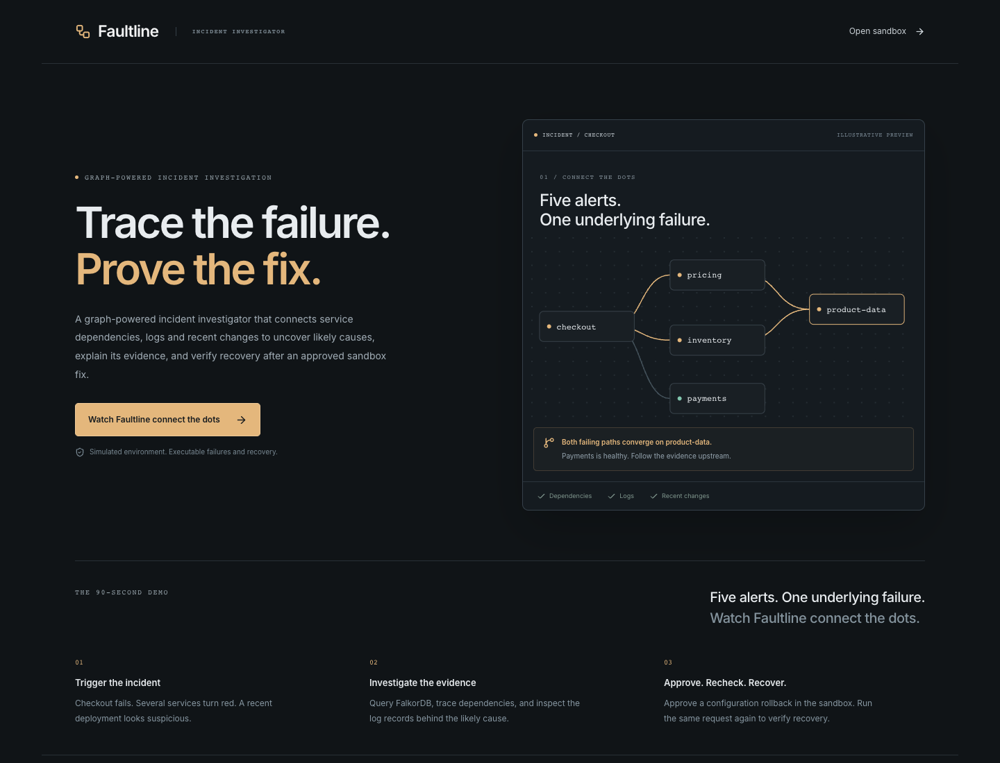
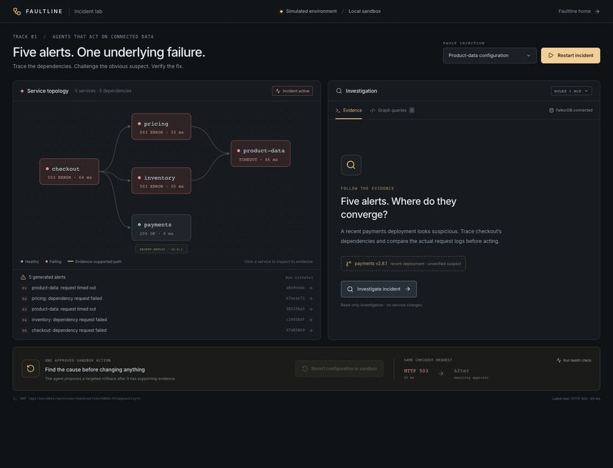
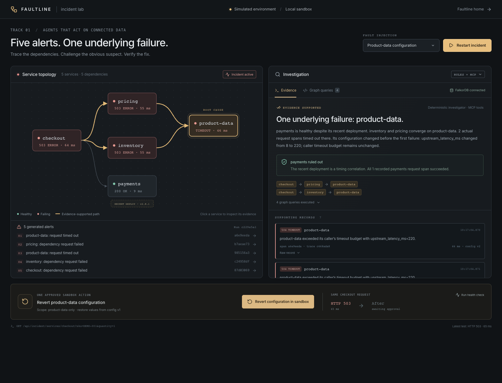
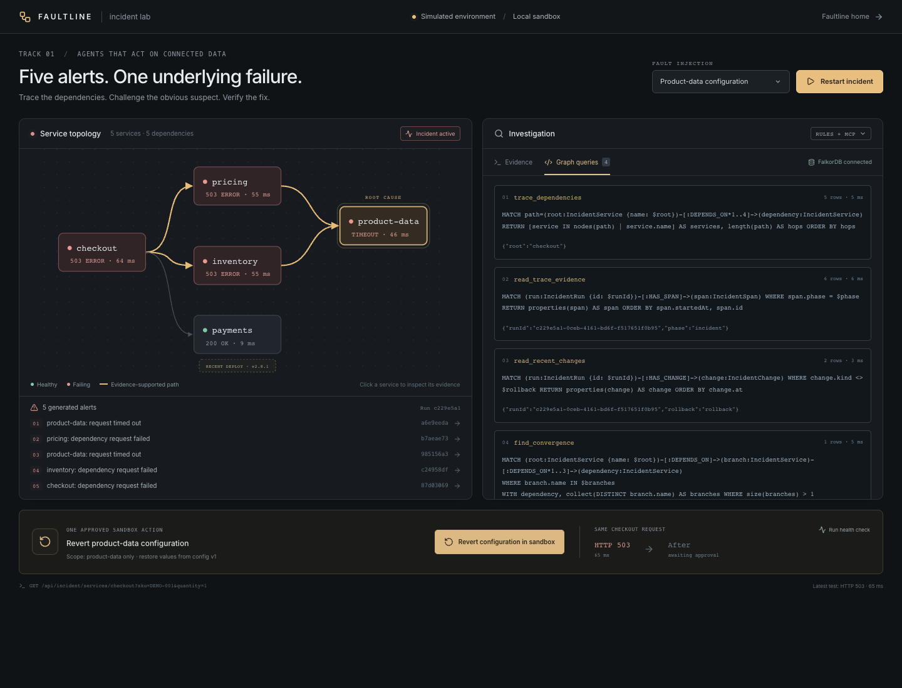
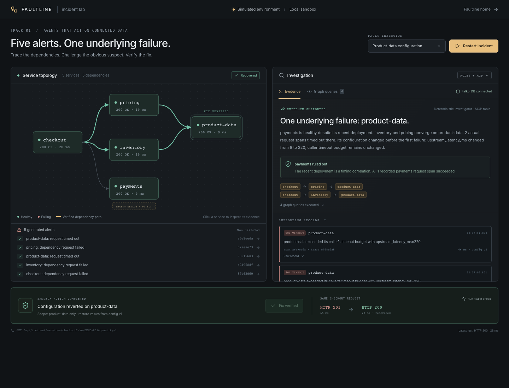
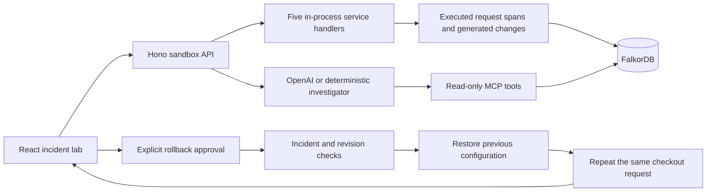

# Faultline

**Trace the failure. Prove the fix.**

Faultline is a graph-powered incident investigator. It connects service dependencies, request traces, and recent changes to explain an underlying failure, propose a targeted sandbox fix, and verify recovery after you approve it.



[Animated walkthrough](#watch-the-workflow) · [The problem](#the-problem) · [How it works](#how-it-works) · [Run locally](#run-the-incident-demo) · [Architecture](#architecture) · [Company Brain workspace](#company-brain-for-itron)

## The problem

When checkout fails, several dependent services can raise alerts at once. Engineers have to connect the dependency map, logs, and change history before deciding what to fix. A recent deployment can look guilty simply because it happened around the same time.

Faultline demonstrates that problem with five generated alerts and a misleading payments release. The investigation follows the failing request paths to their shared dependency, checks actual timeout records and the preceding configuration change, and explains why healthy payments should be ruled out. It then asks for approval before changing the sandbox and reruns the same checkout request to test the result.

The intended user is an engineer investigating a service incident. This repository is an executable local demonstration with simulated services, generated events, and a real FalkorDB graph; it is not connected to production infrastructure.

## Watch the workflow



**20-second screenshot walkthrough:** trigger → investigate → inspect graph queries → approve and verify. [Open or download the MP4](docs/media/faultline-walkthrough.mp4) for a larger view.

These captures come from the running local app using **RULES + MCP**, the deterministic investigator, with real FalkorDB queries. The GIF and silent MP4 sequence four captured states; they are not a continuous screen recording or proof of a live OpenAI run.

## How it works

1. **Reproduce the failure.** Trigger a configuration fault. Checkout executes the local dependency handlers, producing request failures, trace spans, and five alerts.
2. **Connect the evidence.** The investigator uses read-only MCP tools to traverse FalkorDB dependencies, find where failing branches converge, and compare trace evidence with recent changes.
3. **Explain the cause.** Inspect the proposed cause, supporting records, eliminated suspects, and the exact Cypher queries behind the conclusion.
4. **Approve one scoped action.** Review the configuration rollback for the implicated service. The server checks that the approval belongs to the current incident and configuration revision.
5. **Verify recovery.** The server restores the previous configuration and immediately repeats the identical checkout request. A successful response produces the recovered state.

### 1. Several alerts, one investigation


The alerts come from executed sandbox requests. The payments release is a generated decoy; its timing alone does not establish a cause.

### 2. A diagnosis you can inspect



The two failing branches converge on `product-data`. Timeout spans and a preceding configuration change support the diagnosis; successful payment spans rule out the apparent deployment suspect.

### 3. The graph queries behind the answer



The queries are visible alongside their parameters, actual result counts, and execution times. Supporting records also expose raw span and change-event data.

### 4. An approved fix with a measured result



The recovery screen follows a real sandbox rollback and a successful repeat request. Switch the injected fault to payments to demonstrate that the same dependency topology can produce a different diagnosis and rollback target.

## Architecture



| Layer | Implementation | Purpose |
| --- | --- | --- |
| Interface | React, TypeScript, Vite | Dependency graph, evidence browser, query inspection, approval, and verification |
| API and sandbox | Hono on Node.js | Execute simulated services, enforce action boundaries, and rerun checkout |
| Connected evidence | FalkorDB | Store dependencies, incident spans, and change events; traverse and aggregate paths with Cypher |
| Investigation | OpenAI when configured, or deterministic rules | Discover and call the read-only MCP tools; propose an evidence-checked cause |
| Workspace tooling | npm workspaces and moon | Run, build, and check the web and API apps |

The repository also retains the [Company Brain workspace](#company-brain-for-itron), a separate conversational task-coordination demo. Faultline opens at `/#/`; Company Brain opens at `/#/workspace`.

## Run the incident demo

```sh
npm ci
cp .env.example .env
npm run db:up
npm run dev
```

Requires **Node.js 22.12+** and **Docker Desktop running**. If `.env` already exists, keep it and review `.env.example` instead of overwriting your settings.

Open **http://localhost:5173/#/incident** for the sandbox or **http://localhost:5173/** for the landing page. The API listens on `127.0.0.1:3101`; FalkorDB runs at `127.0.0.1:16379`. Optional OpenAI settings are documented in `.env.example`; without a key, the deterministic investigator uses the same MCP graph tools. With a key configured, use the investigation engine toggle to select **RULES + MCP** for the captured walkthrough. The UI identifies which engine actually completed the investigation, including provider fallbacks. Stop the development servers with Ctrl+C; `npm run db:down` stops the database while retaining its volume.

1. Keep **Product-data configuration** selected and click **Trigger incident**. Checkout executes real local endpoint handlers; aborted requests produce five generated alerts and persisted trace spans. The recent payments release is a generated decoy event.
2. Click **Investigate incident**. With an OpenAI key, the model discovers the MCP tools and selects reads. The evidence check requires a failing leaf dependency, direct timeout spans, and a preceding configuration change. Native FalkorDB path traversal and branch aggregation reveal checkout → pricing → product-data and checkout → inventory → product-data. Successful payments spans rule out the deployment as the cause.
3. Inspect **Graph queries** for the actual Cypher, parameters, row counts, and query duration. Click nodes or alerts to filter the evidence; expand **Raw record** for full span IDs, trace parents, timestamps, errors, and configuration revisions.
4. Click **Revert configuration in sandbox**. This click approves one incident-bound, revision-checked action. The server restores the selected service's previous configuration and immediately executes the identical checkout request again. Recovery appears only after the request succeeds.
5. Change the fault selector to **Payments configuration**, click **Restart incident**, and investigate again. The graph edges stay identical; pricing, inventory, and product-data succeed, while payment spans time out. The diagnosis and approved action move to payments. Approve and verify recovery again.

## Executable simulation boundaries

This is explicitly a **simulated local environment**. Five endpoints live inside one Hono app:

- `GET /api/incident/services/checkout`
- `GET /api/incident/services/pricing`
- `GET /api/incident/services/inventory`
- `GET /api/incident/services/payments`
- `GET /api/incident/services/product-data`

Internal Hono requests execute the dependency handlers with real timers and AbortSignals. The injected configuration increases latency from 8 ms to 220 ms, beyond the calling service's timeout. Logs come from those executions; graph health comes from the latest checkout trace. These are in-process service simulations, not independent deployed services or real payment operations.

Incident spans and change events are stored as separate nodes and relationships in the `company_brain_incidents` FalkorDB graph. The five service nodes and dependency edges stay fixed. Live runtime configuration and approval tokens are process-local; restart a fresh incident after restarting the API. No production systems are contacted or rolled back.

## MCP and action boundary

`POST /api/incident/mcp` exposes a stateless JSON-RPC MCP endpoint using protocol `2025-03-26`. The investigator discovers the catalog with `tools/list` and invokes the same `tools/call` request contract that an external client can use. Supported read-only tools:

- `trace_dependencies`: native multi-hop Cypher traversal.
- `read_trace_evidence`: actual incident spans persisted in FalkorDB.
- `read_recent_changes`: generated configuration/deployment event records.
- `find_convergence`: Cypher traversal plus distinct-branch aggregation.

The model does not receive the injected scenario choice. It submits a proposed cause that must agree with the evidence check; insufficient evidence produces no approval. The deterministic fallback computes from those same graph/log records and is labeled in the UI. Rollback is outside the read-only MCP catalog and requires the explicit UI approval token. Arbitrary Cypher, shell commands, and client-supplied rollback targets are not accepted.

Protocol references: [MCP Streamable HTTP](https://modelcontextprotocol.io/specification/2025-03-26/basic/transports) and [MCP tools](https://modelcontextprotocol.io/specification/2025-03-26/server/tools).

## Verify

```sh
npm run check
npm run build
npm run test:incident
```

The normal suite tests real endpoint failure/recovery, both fault locations on the same topology, stale approvals, duplicate actions, concurrent operation guards, MCP argument validation, and refusal to act on a deployment correlation alone. `test:incident` repeats both scenarios against real FalkorDB, asserts the native graph query results, checks HTTP 503 → 200 using the same request, and removes only its own temporary graph. It requires the local database.

The Company Brain app remains available at `/#/workspace`; its existing workspace documentation follows. The incident feature does not require Teams, Outlook, cloud deployment, or elaborate memory.

---

## Company Brain for Itron

A local demo workspace for Itron to coordinate Itron operations, finance, customer support, and technology through an OpenAI conversation. Vite + React + TypeScript, shadcn/ui, Hono, Vercel AI SDK, FalkorDB, and moon for task orchestration.

## Run

Requires Node.js 22.12+ and Docker Desktop running.

The repository pins moon 2.6.1 locally. Root npm scripts invoke moon, which runs
the web and API tasks from their respective folders using your installed Node
and npm. No global moon or proto setup is required.

```sh
npm install
cp .env.example .env
```

Set `OPENAI_API_KEY` in the root `.env`. The default tool-capable model is `gpt-4.1-mini`; change `OPENAI_MODEL` if needed. Keep the key out of frontend code. Restart the backend after changing environment values.

```sh
npm run db:up
npm run dev
```

Open http://localhost:5173/#/workspace. The API listens on 127.0.0.1:3101; FalkorDB on 127.0.0.1:16379. These ports avoid existing local services. `npm run db:down` stops the database without deleting the persistent volume.

For direct moon commands, use the local CLI:

```sh
npx --no-install moon run api:dev web:dev
npx --no-install moon run web:dev
npx --no-install moon run api:dev
npx --no-install moon projects
npx --no-install moon tasks
```

`npm run dev:web` and `npm run dev:api` also run the corresponding moon tasks.
Stop an existing development process before starting another one on these ports.
Backend secrets remain in the root `.env`, which the API loads itself; moon does
not inject them into the frontend. Restart `api:dev` after changing `.env`.

## Home and Tasks

Home is the conversation workspace, with a focused composer and rotating Itron examples. Tasks contains KPI cards, the task list, and employee/system update history. Saved conversations are accessed through the history icon at the top right of Home. The chat uses the official AI Elements attachment component for local previews and saved-message attachments. You can attach up to three PNG, JPEG, WebP, or PDF files totaling 2 MB, with a text question. Files are sent to the configured AI provider when you send the message and saved in local chat history.

## Try it

1. Ask: “Prepare the Itron installation readiness report by Friday. Include meter delivery, gateway availability, and installer access; estimate four hours.” The assistant uses current company data and assigns Leena; Arjun has only two hours free. Missing scope, date or effort triggers conversational clarification. Review the AI Elements confirmation card, then approve to save the task or reject to leave it uncreated.
2. Open the saved task, then **Employee simulator**. Accept as the assigned employee.
3. Report a blocker, such as “Waiting for gateway commissioning before the Itron handover.” See the confirmed update in task details and the founder dashboard.
4. Leave the task open for two minutes to see a simulated automatic check-in. The scheduler checks every 30 seconds.
5. Ask the founder assistant about blockers or remaining capacity.
6. Complete the task in the simulator. Follow-ups stop and capacity is released.
7. Restart the API. Tasks, updates and founder conversations remain in FalkorDB.

The UI uses real OpenAI only. Without a key, connection guidance is displayed. If the database is unavailable, the dashboard shows an explicitly read-only sample preview. A configured key is not proof of model access; provider errors appear in chat.

## Itron demo scenarios

- R&D: route meter calibration and bench validation to Kavya; firmware prototypes and offline-buffer tests to Rohan. Tech handles the deployed platform and telemetry.

- Operations: prepare installation readiness covering meter delivery, gateway availability, and installer access. In a fresh demo, Leena takes a four-hour installation task because Arjun has only two hours free.
- Finance: ask what is blocking Itron water-billing reconciliation; inspect the missing handover readings before creating follow-up work.
- Tech Team: find an owner for a four-hour gateway telemetry investigation; Dev handles IoT and platform work. Track recovery and verify leak-alert notifications.
- Support Team: ask Leena to prepare a resident onboarding guide for the demo community with an agreed scope, deadline, and effort.

Existing demo completions, cancellations, custom tasks, and replies are preserved when original sample records are tailored. Prior chat history remains saved; the Itron conversation uses its own thread.

## MVP boundaries

One Itron demo workspace and six illustrative employees across R&D, Support Team, Tech Team, Finance, and Operations. Task assignments and employee replies in the employee simulator remain simulated. Separately, the Chats page reads real Teams conversations and sends messages as the connected account only when you choose Send. Add delegated `Chat.Read` and `ChatMessage.Send` in Microsoft Entra and reconnect Teams to approve chat access. The page loads conversations and older messages with pagination and refreshes tokens on demand. Automatic messaging and background sync remain deferred. Outlook does not send email. Responsibilities match a declared list, and weekly capacity subtracts estimated effort for open tasks. Calendar availability, leave, working hours, app authentication, multiple companies, production deployment and escalation policies are deferred.

Microsoft connection setup: [configuration and permissions](docs/implementation/microsoft-integrations.md).

The API is an unauthenticated **local demonstration** bound to localhost. Keep it local. Use fake sample company data.

FalkorDB is the only store. For this small demo, one canonical company snapshot is stored alongside entity nodes and ownership/update/message relationships in the same graph query. The API serializes writes in one process. This deliberately simple approach avoids a second database or synchronization worker; it is not a multi-process architecture.

Chat task creation requires approval of a stored proposal. Approval and rejection are persisted; retries cannot create duplicates. Task creation is idempotent per user message. Retries recover already saved work. Server history and tool execution are authoritative; client-supplied tool outputs are ignored. Confirmed employee updates remain distinct from system updates.

## Verify

```sh
npm run check
npm test
npm run test:graph
npm run typecheck
npm run build
npm run lint
```

`npm run check` runs API and web typechecks, API and web tests, and web lint in
moon's task graph. `npm run build` builds both apps, with `dist` outputs declared
for moon caching. Runtime state lives in `.moon/cache/`. `npm run test:graph`
remains an explicit live-database check.
All root scripts use moon; app-level npm scripts are the underlying commands.

The regular suite covers assignment, capacity, task ownership/actions, idempotence, reminders, API validation and streamed AI tool execution/recovery. AI provider mocks exist only in tests. The graph suite uses a disposable graph and verifies real persistence across fresh connections. UI primitives retain standard shadcn source exports; lint may report Fast Refresh/style guidance warnings.

Demo context uses [Itron’s public water-metering overview](https://apac.itron.com/what-we-offer/metering-solutions/water) as a reference. This is an independent illustrative demo, with no affiliation or endorsement implied. Staff, tasks, communities, and updates are synthetic; they do not represent actual operational records. Company Brain coordinates work and does not control meters, approve bills or payments, or deploy software. Live OpenAI and Microsoft behavior requires separate provider verification.

## Live test chat

Open **Live test** in the sidebar, or visit `http://localhost:5173/#/live-test`. This separate Teams-inspired page uses the existing AI chat, saved conversations, attachments, and task approvals.

Type a message and press Enter, or tap the microphone to dictate. Tap it again to finish, review the draft, then send. Voice input uses the browser's speech recognition service (Chrome recommended) and requires microphone permission; it is not a continuous realtime audio session. The speaker button enables browser-generated spoken replies. Typed chat remains available when speech recognition is unsupported.

FalkorDB and an OpenAI key must be configured for live AI replies. The page shows missing connections and links to settings. Seeded work and staff remain illustrative.
